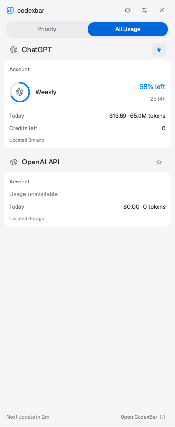

# CodexBar for Herdr

A native Herdr layout with a local CodexBar usage sidebar, provider pins, two display styles, and remaining/used fill.

[Open the layout package](codexbar/) · [Rebuild from scratch](codexbar/RECIPE.md) · [Install and controls](codexbar/README.md)



Requires Herdr, macOS, `/usr/bin/python3`, and local snapshots from [CodexBar](https://github.com/steipete/CodexBar). The mod runs Python to read CodexBar configuration/cache files outside its folder and uses macOS `open -a CodexBar` when requested. It makes no network requests.

Install from a checkout:

```sh
cd codexbar
python3 setup.py
```

The folder follows Herdr’s layout-sharing format: `layouts/`, `mods/`, `RECIPE.md`, and `preview.png`. Herdr supplies the standard workspace mods. The published preview shows the real sidebar cropped to exclude project names and terminal content.
