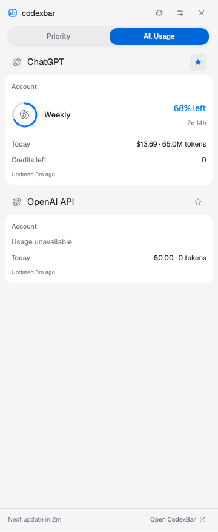

# codexbar for Herdr



[Rebuild from an empty folder](RECIPE.md). The preview is a crop of the running sidebar; the rest of the layout uses Herdr’s standard workspace.

A native, English-language sidebar for the usage snapshots saved by the local CodexBar app.

## Pages and provider pins

The top navigation follows the All Usage / Priority structure illustrated by OpenUsage:

- **All Usage** lists every enabled CodexBar provider, with its accounts and available usage data. Enabled providers without a readable snapshot still appear as unavailable.
- Click the star beside a **provider heading** to pin or unpin that provider. One pin includes all of the provider's accounts and quotas.
- **Priority** lists only pinned providers, in pin order. It never inserts an unpinned provider because a quota is low or exhausted.
- Both pages use the same display setting. Pinning does not move or remove anything from All Usage.

Pins are stored by provider ID, so changing account labels, source account IDs, or quota rows does not discard them. Legacy quota pins are migrated to provider pins. An empty Priority shows an explanation and points to All Usage.

This is the provider-level behavior requested for this mod; OpenUsage itself offers more detailed metric-level pinning and priority rules.

## Display and fill

Sidebar settings offer exactly two display styles:

- **Icons & percentages:** a provider glyph inside a quota ring, plus a non-wrapping percentage and reset countdown.
- **Progress bars:** grouped account cards with quota bars, percentages, reset countdowns, and available usage statistics.

**Fill By** has two options:

- **Remaining** (default): 68% left fills 68% of the ring/bar.
- **Used:** the same quota displays 32% used and fills 32%.

The percentage label and graphic use the same setting. Warning colors always depend on the remaining quota. Zero and 100% are supported without inventing missing data.

The ring graphics use generated 44px SVG assets instead of native path offsets. Provider glyphs are bundled transparent monochrome assets, avoiding the solid tile caused by tinting multi-color background tiles.

Dark, Light, and System appearances are independent of the Herdr window. Light selections use blue fill, white text, and a checkmark; dark selections retain gray fill with a checkmark. Preferences persist in Herdr shared state.

## Refresh

The default interval is **5 minutes**. Choices match CodexBar's fixed refresh modes:
Manual, 1 minute, 2 minutes, 5 minutes, 15 minutes, and 30 minutes. Adaptive modes are omitted.

The interval controls sidebar snapshot reads. CodexBar controls when provider data is fetched. Automatic reads pause while the sidebar is hidden. Manual mode reads once at view startup and supports the refresh button.

## Update

Run from this folder in a regular terminal:

```sh
python3 setup.py --update
```

The updater checks the initial view and all combinations of styles, light/dark appearance, All Usage/Priority, and Remaining/Used fill, plus settings. Populated checks use synthetic data only in isolated checker processes. It backs up the installed mod and layout into `backup-*`, installs assets recursively, and checks Herdr status.

It also captures real-data screenshots for visual verification:

- `verified-icons-remaining.png`
- `verified-icons-used.png`
- `verified-bars-remaining.png`
- `verified-bars-used.png`
- `verified-settings.png`

The capture step temporarily opens All Usage and changes style/fill, then restores the previous page, style, and fill. It does not change provider pins. `installed-codexbar.png` records the restored view.

The updater also opens the installed settings popup, checks for overlay errors,
captures it, and closes that specific popup. Settings scroll directly inside their
allocated bounds: the native scrollbar shortcut wraps the root and can lose its
full-size allocation. The settings checks exercise the real initialization and
focus path as well as its content.

The existing personal layout is retained. A sidebar at the old 304px default is widened to 360px; custom widths remain intact, subject to the 300px minimum.

## Install or remove

For a new installation, omit `--update`. The installer clones `main` to a personal `codexbar` layout with a right sidebar and top-bar toggle; an existing name is never overwritten.

```sh
python3 setup.py
```

To switch back, use `herdr-app do layout.switch --name main`.
To remove this integration into a backup:

```sh
python3 setup.py --remove
```

## Controls

- Top-bar **codexbar**: show/hide the sidebar.
- **All Usage / Priority**: choose providers to view.
- Provider star: pin or unpin the whole provider.
- Header refresh: read the latest saved snapshot.
- Header sliders: refresh interval, display style, fill direction, appearance, and Clear pins.
- Header ×: hide the sidebar.
- Footer **Open CodexBar**: open the local app.
- CLI commands while the panel is shown: `codexbar.all`, `codexbar.priority`, `codexbar.icons`, `codexbar.bars`, `codexbar.remaining`, `codexbar.used`, `codexbar.settings`, and `codexbar.refresh` via `herdr-app do`.

## Data and limitations

This implementation currently targets macOS. It uses `/usr/bin/python3`, macOS `open -a`, and known CodexBar snapshot paths. Windows/WSL and Linux adapters are not implemented.

It reads Widget snapshots, Codex account snapshots, and the available CLI usage cache. Account labels are used when provided; email-based labels become Account. An unavailable account never borrows a sibling's quota. Credentials and email addresses are not emitted to the UI. Usage older than 15 minutes is marked Stale.

The sidebar is local to this computer and does not follow remote Herdr spaces. Group-container permissions may limit available data. CodexBar's private snapshot schema may change.

References:

- [OpenUsage dashboard](https://github.com/robinebers/openusage/blob/main/docs/dashboard.md)
- [OpenUsage display settings](https://github.com/robinebers/openusage/blob/main/docs/settings.md#usage-display)
- [CodexBar Widget snapshot](https://github.com/steipete/CodexBar/blob/main/Sources/CodexBarCore/WidgetSnapshot.swift)
- [CodexBar fixed refresh frequencies](https://github.com/steipete/CodexBar/blob/main/Sources/CodexBar/Settings/SettingsStore.swift)

## Validation

From this layout folder:

```sh
python3 -m unittest discover -s tests -p 'test_*.py' -v
node --experimental-vm-modules --test tests/model.test.mjs tests/render.test.mjs
python3 setup.py --verify-only
```

Unit and view-description checks do not prove final pixel rendering. Native checks and the captured real-data screenshots are needed for the visual result.
