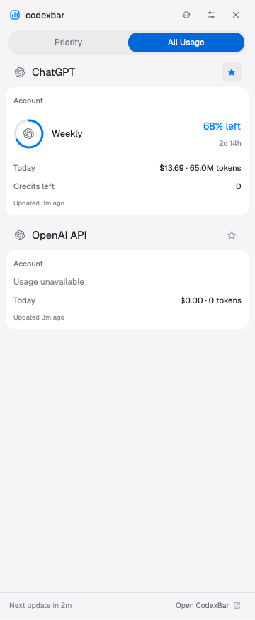

# codexbar

A normal Herdr workspace with spaces and agents on the left, terminals in the middle, and a compact CodexBar usage sidebar on the right. The English sidebar groups accounts by provider, lets people pin providers to a separate Priority page, and offers either quota rings with percentages or progress bars. The preview is cropped from the running sidebar; the surrounding workspace uses Herdr's shipped interface.



## What you see

- The left workspace sidebar starts at 268px, resizes from 44–480px, and contains a 46px brand header, equal spaces/agents regions with 90px minimums, and a 69px footer. Use the person's Herdr colors, fonts, workspace controls, and agent presentation.
- The work area has a 42px tabs row, a flexible body with 8px padding and gaps, and a 28px status bar. Terminals have 14px vertical/12px horizontal padding, 10px corners, 1px borders, and 30px pane headers. Files/Changes occupy the standard hidden 368px panel, resizable from 280–900px.
- A 112px codexbar toggle sits at the right end of the tabs row. The usage sidebar starts at 360px, resizes from 300–520px, and fills the work body's height.
- Its 43px header shows a blue mark, “codexbar”, refresh, settings sliders, and close. Below it is a pill selector: Priority / All Usage. The footer is 37px high, with the next-read countdown and Open CodexBar.
- Each provider has an 18px glyph, a 15px semibold name, and one star. Rounded 13px account cards show an account label, optional plan badge, quota rows, available Today cost/tokens, credits, reset credits, code-review percentage, extra-usage budget, and source update age. Omit statistics that are absent. Enabled providers with no readable usage remain visible as “Usage unavailable”.
- Progress bars are 6px high. Their rows have a 57px quota label, flexible bar, 62px percentage column, and 45px reset column. Icons & percentages uses a 44px ring with a 19px provider glyph, a flexible quota label, and a fixed 92px percentage/reset column. Keep percentages on one line.
- Dark colors: background `#1e1e1e`, cards `#252525`, raised `#303030`, track `#383838`, text `#e6e6e6`, muted `#979797`, selected `#555555`. Light: `#f5f5f7`, `#ffffff`, `#ebebee`, `#e1e1e6`, `#202024`, `#717179`, selected `#0067d9`. Selected text is white with a checkmark. Healthy quota is blue (`#0a84ff` dark / `#007aff` light); remaining quota ≤20% is orange (`#ff9f0a` / `#b86000`), and zero is red (`#ff453a` / `#d92d32`).

## How it behaves

- All Usage lists enabled providers and every available account. A provider star pins all its accounts and quotas. Priority shows only pinned providers, in pin order. Unpinning removes a provider from Priority immediately; low quota never adds an unpinned provider. Empty Priority explains how to star a provider; unavailable saved pins have a separate explanation.
- Settings opens a 320×610px pointer popup, with 16px padding, 12px gaps and corners, and these controls: Refresh Interval (Manual, 1, 2, 5, 15, 30 minutes); Display Style (Icons & percentages / Progress bars); Fill By (Remaining / Used); Appearance (Dark / Light / System); pinned count and Clear pins. Changes save immediately and remain visible when settings reopens. Close or Escape dismisses the popup. Buttons highlight on hover; choices retain a visible selected fill and checkmark.
- Defaults: 5-minute reads, Progress bars, Remaining, Dark, All Usage, no pins. At 68% remaining, Remaining shows “68% left” and fills 68%; Used shows “32% used” and fills 32%. Warning colors always use remaining quota. Both pages use the same display style.
- Read once at startup, including Manual mode. Refresh reads the newest local snapshot; it does not fetch provider usage. Show a native spinning refresh icon while reading. A 5-second scheduler checks whether the selected read interval has elapsed and updates the footer only when its text changes. Pause automatic reads while the sidebar is hidden. Source timestamps older than 15 minutes say Stale; a passed reset says Due now until CodexBar updates it. Missing timestamps and quotas stay unknown.
- The tabs-row toggle shows/hides the sidebar; header close hides it. Open CodexBar launches the local application. Read/open errors appear inside the sidebar. Hide/show preserves preferences and pins. Sidebar dividers resize; ordinary workspace tabs, panes and drag areas retain Herdr's behavior.
- Agent statuses belong to the shipped left sidebar: working is a 12px spinner (900ms rotation); blocked is Needs you or a compact orange “!” badge; done is a filled dot; idle is a hollow ring with subdued unfocused text. Colors use the corresponding Herdr theme tokens. Clicking an agent focuses its pane. CodexBar quota colors do not represent agent status. No additional key bindings are installed.

## Built from

Create `layouts/codexbar.json`, `layouts/codexbar.svg`, and `mods/codexbar/` containing `main.js`, `model.js`, `read_usage.py`, `mod.json`, action/provider SVGs, and `rings/1.svg` through `rings/100.svg`. Keep this recipe and `preview.png` beside `layouts/` and `mods/`.

The layout is a personal clone of shipped `main`, using this tree:

```text
root row (no system titlebar; macOS traffic lights at 12,16)
├─ sidebar column
│  ├─ brand: workspace-chrome
│  ├─ sidebar-lists column → spaces, agents
│  └─ sidebar-footer: workspace-chrome {footer:true}
└─ work column
   ├─ codexbar-tabs-row → tabs, codexbar {role:"toggle"}
   ├─ work-body row
   │  ├─ main: active tab with shipped pane headers
   │  ├─ panel (hidden) → panel-body stack → files / changes
   │  └─ codexbar-sidebar: codexbar (default panel role)
   └─ status: workspace-status
```

Herdr supplies `workspace-chrome`, `spaces`, `agents`, `tabs`, `pane`, `files`, `changes`, and `workspace-status`; keep those references and do not bundle modified copies. Use `gpui-kit`/`gpui-base`, not a browser. The mod has `{place:"none",title:"codexbar",focusable:true}`. Its third role, `{role:"settings"}`, renders the popup, focuses its own handle, and does not start usage reads.

Use `theme`, `settings().dark`, `layout`, `props`, `shared`/`setShared`, `nextCommand`, `appHome`, `exec`, `openOverlay` and `closeOverlay`. Use `layout.toggle`/`layout.hide` for visibility. Store preferences under `codexbar.preferences.v2` with interval, display, appearance, page, fill and `pinnedProviders`; deduplicate provider IDs and migrate legacy quota pins by their provider prefix. Clearing pins must remain empty after migration. Support mod commands `focus`, `refresh`, `settings`, `close-settings`, `all`, `priority`, `icons`, `bars`, `remaining`, and `used`; `cards` and `detailed` alias bars. Track the opened settings ID so close-settings closes only that popup.

Run `/usr/bin/python3 <appHome>/mods/codexbar/read_usage.py` with a 10-second timeout. The standard-library helper reads, at most 4MiB per JSON file:

1. `~/.config/codexbar/config.json` for enabled provider IDs.
2. The freshest `widget-snapshot.json` in `~/Library/Application Support/CodexBar/` or `~/Library/Group Containers/{Y5PE65HELJ.com.steipete.codexbar,group.com.steipete.codexbar}/`.
3. `codex-account-snapshots.json` in Application Support/CodexBar if Codex accounts are missing.
4. `CLIUsageCache/usage.json` there for providers still missing.

Prefer widget per-account usage over its selected-provider entry. Never give an unavailable account a sibling's quota; filter disabled providers and append unavailable placeholders for enabled providers without data. Normalize `usageRows` or primary/secondary/tertiary windows into `{id,label,left,used,resetsAt}` (max 12/account); derive left from usedPercent, clamp to 0–100, reject non-finite values. Convert 300/1440/10080/43200-minute windows to Session/Daily/Weekly/30 days. Accept ISO or Unix timestamps; numeric account-snapshot dates use Apple's epoch, adding 978307200 seconds. Emit provider/name/account/plan/update time, windows, and available metrics described above. Replace email or Chinese account labels with Account; hash account IDs for anonymous stable entry keys. Pins use provider IDs, not account hashes. No credentials or raw account IDs reach the UI. The helper makes no network calls. The footer action runs `/usr/bin/open -a CodexBar`.

Use monochrome provider glyphs from CodexBar's ProviderIcon assets with its MIT notice. Unknown providers use the generic mark. Generate ring SVGs in a shared 44×44 coordinate system: center 22, radius 19, 3px stroke, round cap, starting at the top, filled clockwise by percentage. Zero draws only the track. Bundle the mark, refresh, settings, close, external, star, filled-star and check SVGs. The layout's SVG thumbnail is separate from the screenshot.

## Watch out

- This build targets macOS with CodexBar, readable local snapshots and `/usr/bin/python3`. Windows/Linux adapters are absent. CodexBar controls upstream refresh and its private cache schemas may change. Permissions can block Group Containers. The sidebar remains local when a remote Herdr space is selected.
- On this Herdr build, `overflow_y_scrollbar()` wraps a root and can lose its size allocation, making a popup invisible. Give settings a named, full-size root and use `overflow_y_scroll()` directly. Check actual popup layout, not only its initial element description.
- Use static ring geometry and transparent provider glyphs. Native arc placement and tinting colored tiles previously produced fragmented rings and solid icon backgrounds. Fixed percentage columns and no-wrap labels prevent broken numbers at 300px width.
- Keep unknown usage distinct from 0%, and preserve true zero values for costs and credits. Limit saved pins to 100. Render multiple accounts under one provider star. Do not invent exhausted-provider sections in Priority.
- Install into unoccupied names; if renaming, update layout references, self-opening overlay names and asset paths together. Preserve shipped files, personal settings, terminals, and unrelated keys. Native initial checks do not exercise asynchronous data, layout sizing or popup clicks.

## Done when

- `herdr-app check` passes for the mod, both settings appearances, and populated bars/icons × light/dark × All Usage/Priority × Remaining/Used scenarios.
- After switching to codexbar, the ordinary workspace works and its toggle/close controls hide and restore the sidebar. At 300px width, rings, percentages, resets, and provider icons remain aligned.
- All Usage lists multiple accounts together; pinning one provider shows all of them in Priority and leaves other providers out. Unpin, Clear pins, hide/show and reopen preserve the expected state.
- The actual settings button opens a visible popup; all choices update, remain selected in light/dark, and persist. Close and Escape work. Capture this interaction as well as both display styles; a passing initial check alone is insufficient.
- A 68%-left fixture displays/fills 68% in Remaining and 32% in Used. Zero, 100%, missing quota, stale data and passed resets render correctly. Manual has no automatic reads; the 5-minute default, refresh button and hidden-sidebar pause behave as described.
- Real local snapshots produce usage or an honest unavailable/error state. The helper output contains no email addresses or credentials. Open CodexBar launches the app.
- The shared folder contains only the layout, its custom mod/assets, build brief, screenshot, installation instructions, tests and third-party notices. It includes no personal Herdr state or local cache data.
